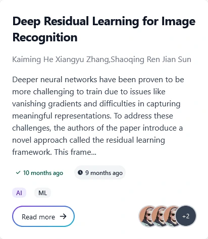

# ReSearch

A site for sharing and reviewing AI research papers, inspired by ResearchGate and arXiv: users upload PDF papers, comment and favourite them, and moderators verify papers in their categories.

Built between December 2023 and March 2024 as the project for a web development course: a full stack with a React front end, a hand-written PHP API and a MySQL database, including roles, file uploads and moderation.

**Status:** no longer hosted. It ran on Netlify (front end) and Render (API) during the course; the screenshot below shows it running. To try it, run it locally (steps below).



## Features

- Register and log in (passwords hashed with PHP `password_hash`), with avatar upload in settings
- Upload papers as PDF with categories; papers can be deleted but not edited
- Read papers in the browser, comment on them, and favourite them
- Search by title and filter by category
- Three roles: users, superusers who verify papers in their assigned categories, and an admin who assigns superusers from a dashboard

## Stack

- Front end: [React 18](https://react.dev) with [Vite](https://vite.dev), [React Router](https://reactrouter.com), [Tailwind CSS](https://tailwindcss.com), [Flowbite React](https://flowbite-react.com)
- Back end: plain PHP (PDO) on Apache, action-based JSON endpoints
- Database: MySQL (schema and sample data in `researchdb.sql`)

## Project structure

```
reSearch/
├── frontend-reSearch/        # React app
│   └── src/{pages,components,helper}
└── backend-reSearch/
    ├── Dockerfile            # PHP + Apache image
    └── api/                  # index.php (auth), posts.php, singlePost.php,
                              # comments.php, dashboard.php, DbConnect.php,
                              # researchdb.sql, papers/ and img/ uploads
```

## Run locally

**Database and API** (e.g. with XAMPP):

1. Create a MySQL database named `researchdb` and import `backend-reSearch/api/researchdb.sql`.
2. Copy `backend-reSearch/api` into your web root (`htdocs/api`), so it is served at `http://localhost/api/`.
3. Set the connection details in `api/DbConnect.php` (the file has a commented-out local config).

**Front end** (port 5173):

```sh
cd frontend-reSearch
npm install
npm run dev
```

Environment variables (names only): `VITE_DEV_API_URL` and `VITE_PROD_API_URL`, the API base URL for dev and production builds.

## Deploy

- Front end: `npm run build` in `frontend-reSearch/` and deploy `dist/` to a static host (it was on Netlify; see `netlify.toml`).
- API: `backend-reSearch/Dockerfile` builds a PHP + Apache image with the PDO MySQL driver (it was on Render, with a separate MySQL server).

## License

[Apache 2.0](LICENSE)
